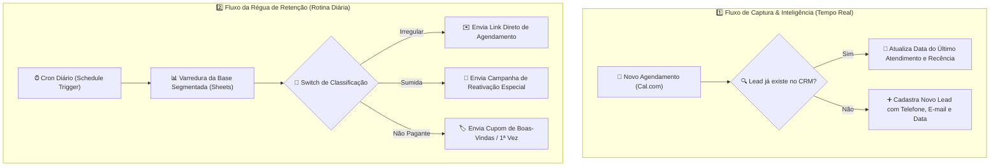

# 🔄 Sistema de Retenção & Marketing de Ciclo de Vida (Matriz RFM)

### *Transformando dados parados em faturamento previsível para negócios de serviço recorrente.*

---

## 🚫 O Problema

> *"Automatizar sem critério só faz você mandar spam mais rápido."*

Em negócios de serviços recorrentes (como estética, beleza e nail design), o lucro não depende apenas de atrair novos clientes todos os dias — **o dinheiro real está em garantir a frequência e a manutenção**.

O grande obstáculo? **Controlar de cabeça quem sumiu há 30, 60 ou 90 dias é humanamente inviável na correria dos atendimentos diários.** Quando o profissional tenta fazer follow-up manual:
- Esquece contatos importantes;
- Manda mensagens genéricas para todo mundo;
- Perde clientes que esfriaram silenciosamente.

---

## 🧠 A Estratégia: Inteligência de Dados (Matriz RFM)

Antes de abrir qualquer ferramenta, foram definidos critérios claros para classificar a base de contatos pelo comportamento real de compra (com foco em **Recência**):

| Status | Classificação RFM | Comportamento do Cliente | Ação da Automação |
| :---: | :--- | :--- | :--- |
| 🟢 | **Recorrente Fiel** | Retorno em menos de 30 dias | Mantém régua de valor e experiência VIP. |
| 🟡 | **Irregular** | Recência entre 30 e 60 dias | Disparo de **lembrete preventivo** com link direto de horário. |
| 🔴 | **Sumida** | Mais de 60 dias sem agendar | Entrada imediata na **régua de reativação** com oferta especial. |
| ⚪ | **Não Pagante** | Pediu informações, mas não fechou | Disparo de **cupom de primeira experiência** para quebra de objeção. |

---

## 🏗️ Arquitetura das Automações

O ecossistema é dividido em dois motores assíncronos construídos no **n8n**:

---

## ⚙️ Detalhamento Técnico dos Fluxos

### 1. Captura e Atualização Automática
- **Gatilho:** Webhook disparado pelo evento `BOOKING_CREATED` do **Cal.com**.
- **Validação de Duplicidade:** O nó do **Google Sheets** faz uma busca combinada (`OR`) por Telefone ou E-mail.
- **Roteamento Condicional (If):**
  - Se `row_number` existir: atualiza a linha correspondente com a data da sessão.
  - Se for lead novo: faz o *append* completo (Nome, Telefone, E-mail e Data de Início).
- **Impacto:** Zero necessidade de digitação ou cadastro manual de fichas.

### 2. Régua de Relacionamento Inteligente
- **Gatilho:** Rotina agendada periódica (`Schedule Trigger`).
- **Segmentação Dinâmica:** O nó `Switch` avalia o campo `Classificação` calculado na planilha.
- **Disparos Contextuais:** Cada perfil recebe apenas a mensagem desenhada para o seu estágio de relacionamento, evitando desgaste de imagem e cancelamentos.

---

## 🛠️ Stack Tecnológica

- **Orquestrador de Automações:** [n8n](https://n8n.io/)
- **Gestão de Agendamentos:** [Cal.com](https://cal.com/)
- **CRM / Banco de Dados Relacional:** Google Sheets (autenticação segura via Service Account)
- **Protocolo de Comunicação:** SMTP / E-mail Transacional (compatível com WhatsApp API / Z-API / Evolution)

---

## 📊 Resultados e Diferenciais

- **Faturamento Previsível:** O sistema resgata clientes antes que troquem de profissional.
- **Sem Spam:** Cada cliente recebe comunicação personalizada e no momento certo.
- **Escala com Mão de Obra Zero:** Funciona 24 horas por dia, 7 dias por semana, sem intervenção humana.

---

## 🔒 Propriedade Intelectual & Contato

Este repositório é uma **apresentação pública de arquitetura e portfólio técnico**. 
As credenciais, regras de cálculo dinâmico e os fluxos de produção originais são protegidos.

Desenvolvido para operações de alto rendimento.
📩 **Gostaria de implementar essa estrutura na sua operação?** Entre em contato via LinkedIn ou e-mail.
